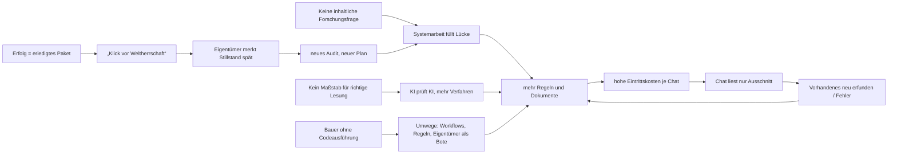

# Systemaudit paleo-type, November 2026: Prüfer Claude (#398)

Stand: `main@22b255b`, 03.11.2026. Auftrag: #398. Der zweite, unabhängige Prüfer ist ChatGPT (#400). Dieser Bericht ist **Befund und Vorschlag**. Er beschließt nichts, ändert keine Regel und ist nicht zur Übernahme auf `main` gedacht.

## Berichtigung vom 03.11.2026 (nach Einwand des Eigentümers)

Der Eigentümer hat eingewandt, dieser Bericht mache es sich zu einfach und rate. Daraufhin habe ich die folgenden Aussagen gegen das Repo nachgeprüft. Der ursprüngliche Text bleibt unten stehen, damit nachvollziehbar ist, was berichtigt wurde. Wo er dieser Berichtigung widerspricht, gilt die Berichtigung.

1. **U2 ist als Ursache widerlegt.** Auch Knau hatte keine Forschungsfrage des Eigentümers und kam dennoch voran. Die Methode verlangt nicht zwingend eine Frage, sondern „an explicit question **or required source-representation task**“ (`methodology/historical-source-workflow.md`, Abschnitt „Research-question control“). Die fehlende Frage erklärt die Systemphasen also nicht.
2. **Die Fehlerquote in U1 und Abschnitt 4 ist überdehnt.** Die Gegenleser wählen ihre Stellen selbst; bei Namensstellen kommen die unsicheren zuerst (`docs/gegenlesung-vorab.md`, Z. 47 und 109). „1–2 von 3“ beschreibt deshalb schwierige Stellen und keine allgemeine Lesequote. Die Folgerung, die Wand sei „fachlich, die KI kann diese Hand nicht“, ist damit **nicht belegt**.
3. **Die fachliche Methode ist im Repo vorhanden.** Ich hatte nahegelegt, das Vorgehen eines Fachmanns fehle. Tatsächlich steht es da:
   - S1–S9 in `historical-source-workflow.md`: S2 beschreibt Struktur und Dokumentart vor dem Lesen, S4 ist ein elfstufiger paläographischer Test mit lokalisierten Vergleichsstellen und unterscheidenden Merkmalen.
   - Die Anforderungen REQ-PAL-001 bis REQ-PAL-010 in `requirements/domain-requirements.tsv`.
4. **Neuer Befund: Erfahrung zu sammeln wurde ausdrücklich zurückgenommen.** Knau hatte `palaeography/lexicon.tsv` und `numerals.tsv`. Am 08.09. wurden sie zu Altbestand erklärt (#124; Nachträge zu L001 und L004). Seitdem steht in `palaeography/README.md`: „not an instruction to build a project-wide palaeographic lexicon or concordance … Do not extend these legacy tables merely because similar forms exist.“ Begründet wurde das damit, dass die Gleichheit der Hand nicht nachgewiesen war. Die Folge: Es gibt keinen Ort, an dem sich Erfahrung mit einer Hand, einer Kanzlei oder einem Formular über mehrere Sitzungen ansammelt. Das steht in Spannung zum Ziel, die Arbeitsweise eines erfahrenen Fachmanns nachzubilden. L029 benennt die Gefahr bereits: Das System ist sicherer, aber möglicherweise weniger leistungsfähig.
5. **Neuer Befund: Bei Nr. 632 wurde die Übersicht angelegt, dann aber das Ziel gewechselt.**
   - Eine Funktions- und Inhaltskarte über alle 135 Aufnahmen liegt vor (`research/content-document-function-inventory-2026-10-30.md`, #350): 24 Bereiche, überwiegend als „Kandidat“ eingeordnet, ohne Regest (wer, an wen, wann, worüber). Dazu kommen Chronologie und Quellenkritik (#351, #352).
   - Danach setzte #358 als Ziel eine „möglichst vollständige diplomatische … Transkription **aller** einzigartigen sichtbaren Schriftflächen“.
   - Der Eigentümer beschreibt sein Vorgehen anders: erst Struktur und grober Inhalt, dann setzt er Prioritäten.
   - Wer das Ziel in #358 formuliert hat, lässt sich nicht prüfen: Alle Beiträge stammen vom Konto `esany`.
6. **Ein Werkzeug für den Bildvergleich gibt es schon als Prototyp:** `tools/regii5_visual_retrieval.py` (#141, #148). Ergebnis des Versuchs: Exakter Vorlagenabgleich ist „not allograph-robust enough“ für schwierige Zeichen (`same-source-visual-retrieval-spike-2026-09-10.md`). Auf Nr. 632 wurde er nicht übertragen.
7. **Bekannte KI-Fehlerbilder sind im Repo belegt, die Bildauflösung aber nicht.**
   - Belegt sind: Wortbildraten L001, Sinnzusammenhang als Lesehilfe L002, Namenswissen L003, Metadaten als Inhalt L005, wiederholte KI-Lesung ohne Unabhängigkeit L006, übernommene Prämisse in der Prüfung L023, Unterstützungsarbeit verdrängt Forschung L028.
   - Die Bildauflösung (kompakte gegenüber voller Fassung, Neulesung an der nativen JPEG-Aufnahme) taucht nur in der Arbeitspraxis von Nr. 632 auf (#359, Methodenprotokoll), nicht in der Methode.
8. **Abschnitt 8 ziehe ich zurück, soweit er Kennzahl, Lesbarkeitsprobe und Regel-Limit als Kern vorschlägt.** Diese Vorschläge setzten das Ziel herab, statt zu fragen, welche Strukturen die nachgebildete Facharbeit tragen. Eine neue Fassung von Abschnitt 8 gehört in die Synthese. Sie muss den Befund 4 und die Methode S1–S9 zum Ausgangspunkt nehmen.

Weiter belegt bleiben U3 bis U6 und die Abschnitte 1, 3, 6 und 9.

## 0 · Geprüft gegen / nicht geprüft

**Geprüft gegen:**
- `GOVERNING_OBJECTIVE.md`, `AGENTS.md`, `methodology/research-gates.md` (G1–G6)
- Gliederung von `DECISIONS.md` und `MILESTONES.md`
- `projects/ega-reg-ii-5-knau/STATUS.md` und `LEARNINGS.md`, `projects/ssta-20578-nr-632/ARBEITSPLAN.md`
- alle 400 Issues und PRs (Titel, Labels, Datum, Kommentarzahl; Volltext ausgewählter Issues: #89, #129, #230, #353, #368, #394, #398)
- vollständige Git-Historie von `main` (1.054 Commits) mit Zeilenbilanz je Phase und Bereich
- Historie von `AGENTS.md`, `methodology/workflow.md` und `SPICKZETTEL.md`
- PR #359 (Dateiliste, Commits) sowie die Zahlenspalten von `research/methodenprotokoll.md` auf dessen Branch
- `esany/design-lab` und `esany/wissensarbeit` (Git-Historie, README/Intent, design-lab-Befund `research/2026-10-audit-paleo-type/befunde.md`)

**Nicht geprüft:**
- die Lesungen selbst (Prüfer und Eigentümer lesen keine Handschrift)
- die Volltexte der meisten Issue-Diskussionen; die Kommentarzahlen sind erfasst, gelesen ist nur eine Auswahl
- die 25 Audit- und 42 Recherchedateien in `engineering/evidence/` (nur Namen und Umfang)
- CI-Läufe; Tests habe ich nicht erneut ausgeführt, weil dieses Audit keinen Code bewertet
- Chatverläufe und ChatGPT-Erinnerungen (kein Zugriff)
- die Zeit des Eigentümers: nicht messbar, weil alle 400 Issues und PRs vom selben Konto `esany` stammen

**Unabhängigkeit:** Den Bericht #401 (ChatGPT) habe ich nicht geöffnet. Frühere Analysen (#394, #396, Projektnotiz, #368) sind als **Aussagen Betroffener** behandelt. Sie werden zitiert, aber nicht als Befund übernommen.

**Blindheit:** Keine Lesungsdatei von Nr. 632 geöffnet. In den Zahlenspalten des Methodenprotokolls standen einzelne Wortformen zu 0106R/0107L, 0110L, 0110R, 0113L und 0114R. Für diese Seiten ist dieser Chat nicht mehr ganz blind.

## 1 · Herkunft und Phasen

Zeilenbilanz: hinzugefügte Zeilen auf `main` nach Bereich (`git log --numstat`). Forschung = `projects/`, `corpus/`, `entities/`, `source-entry/`; Verfahren = `methodology/`, `requirements/`, `docs/`, Wurzeldateien; Code = `tools/`, `tests/`, `.github/`; Engineering = `engineering/`.

| Phase | Zeit | Forschung | Verfahren | Code | Engineering | Was geschah |
|---|---|---:|---:|---:|---:|---|
| 1 Gründung | 26.–31.08. | 4.401 | 8.297 | 1.544 | – | Leitziel, 14 „Future structural audit“-Issues je Fachgebiet (#26–#39), Projektmodell in fünf Fassungen (D-011 → D-018, #129 Befund 3) |
| 2 Bereinigung | 01.–03.09. | 383 | 965 | 1.307 | – | Externer Review #89: „zu viel Meta-Arbeit“. `AGENTS.md` von 375 auf 187 Zeilen gekürzt (Salvage #92/#93) |
| 3 **Knau** | 04.–13.09. | **5.955** | 1.713 | 1.983 | – | Reg. Ii 4 fol. 306v–309r und Reg. Ii 5 fol. 61v–63r: Erstlesung, G2-Prüfung, G3, kontrollierte Kollation (#96–#166) |
| 4 Programm | 14.–30.09. | 533 | **15.470** | 333 | – | „Research-system programme“, Synthese, Reifegradmodell, Route B (#177–#228); Dokumente bis 1.070 Zeilen in `requirements/` |
| 5 Bugwave / SD-KA | 01.–09.10. | 890 | 12.139 | 4.985 | 5.167 | Adäquanz-Audit #230, Engineering-System SD-KA-01 mit WP1–WP6 in zwei Tagen (#256–#302, 169 Commits am 05.10.), Akquise `savesax`, Einstieg Nr. 632 |
| – Pause | 10.–26.10. | | | | | keine Commits |
| 6 Nr. 632 | 27.10.–03.11. | 1.159 | 399 | 1.540 | 115 | Eigentümerplan, Spickzettel, Gegenlesung, Edition als Website; #394 stellt die Abweichung von der Methodik fest; Pause #399 |

Hinweis: Die Forschung von Nr. 632 liegt größtenteils **nicht** auf `main`. PR #359 umfasst 153 Commits und +2.203 Zeilen, davon 1.629 in einer Markdown-Datei und 11 Rückmelde-JSONs.

**Bestand heute** (Zeilen): `engineering/` 32.331 · `tools/` 5.195 · `tests/` 4.604 · `methodology/` 2.326 · Wurzeldateien 1.097 · `projects/` 6.660. Offen: 47 Issues, 9 PRs, 64 Branches. 18 Issues sind versehentlich angelegte Platzhalter oder Verbindungstests (#80–83, #103, #151, #163, #182, #209, #210, #216, #221, #236–238 u. a.).

**Schwesterrepos:**
- `wissensarbeit`: 217 Commits vom 05.08. bis 03.10. Die letzten 25 Commits handeln nur von Cursor, Abschluss, Abgleich und Tests zur „owner-burden“-Regel; seit dem 03.10. gibt es keine Commits mehr.
- `design-lab`: begonnen am 27.10. Schon am 29.10. stellt der Eigentümer die Frage „Bremst die Systementwicklung das Fach?“ (`be2ae50`, #94); am 30.10. folgt ein Audit zu paleo-type (#114) und ein „Umbauplan zum Organismus“ (#106).

## 2 · Was der Eigentümer will

**Gesagt (Repo):**
- eine hochwertige, korrekte Edition mit so wenig Aufwand wie nötig; ganzheitlich, systemisch, transparent (#398)
- Er liest keine Handschrift, er steuert mit Stichworten, Absicherung ist Sache des Systems (`ARBEITSPLAN.md`, #398).
- Fortschritt soll man an Seiten und Fehlerquote sehen (Abschnitt „RÜCKMELDUNG“ im `ARBEITSPLAN.md`).
- Werkzeuge nur aus belegter Reibung und erst nach seiner Freigabe (W0–W3).

**Gesagt (Antworten auf die Eingangsfragen, 03.11.):**
- Zweck: „Erstmal eigene Forschung“
- Umfang: „Offen, viele Quellen“
- Fachleute: „Das sollte nicht relevant sein“
- Verlauf: „Es sind immer Wellen. Wir haben einen Plan, der plausibel klingt, es läuft, einen Klick vor der Weltherrschaft, und dann läuft es ohne Fortschritte; das ist für mich nicht wirklich transparent. In den Visitationsprotokollen viel mehr als aktuell. Wir stehen auf der Stelle, ich hinterfrage und sehe uns vor der Wand. Das ist zyklisch.“

**Erschlossen (nicht gesagt):**
- E1: Im Repo steht keine inhaltliche Forschungsfrage des Eigentümers, also nicht, *was* er aus den Quellen wissen will. Belegt ist nur die Gegenrichtung: Knau endete am 13.09. mit „No owner-selected active scholarly scope“ (`ega-reg-ii-5-knau/STATUS.md`).
- E2: „Viele Quellen“ und „eigene Forschung“ sind kein Auftrag zum Bau eines allgemeinen Forschungssystems. Gebaut wurde es trotzdem (Phase 4 und 5).
- E3: Die Antwort „Fachleute nicht relevant“ steht in Spannung zu Invariante 4 des Leitziels. Dort ist die fachliche Prüfung als Eskalationsstufe vorgesehen. Siehe Ursache U1.

## 3 · Was aus den Anforderungen wurde

| Anforderung | Entstandene Struktur | Dient der Methodik? | Kosten |
|---|---|---|---|
| Belegen statt plausibel ergänzen | `transcription-guidelines.md`, Aussageebenen, LEARNINGS L001–L006 | **ja**, aus echten Fehlern (Silhouettenraten L001, Namenswissen L003) | gering; der Kern ist ca. 400 Zeilen |
| Herkunft und Quelle/Datei trennen | `corpus/source-contract.json` + `tools/source_contract.py` + Tests | **ja**, ausführbar | mittel (818 Zeilen Code); fünf Modellwechsel in sechs Tagen (#129) |
| Reifegrade | G1–G6 (`research-gates.md`) | **ja**; Knau hat G2–G4 für einen begrenzten Abschnitt erreicht | gering |
| Wiederaufnahme ohne alten Chat | STATUS, LEARNINGS, Übergaben, `work_return.py`, Rückmelde-JSONs, Spickzettel | teilweise. Der Knau-STATUS trägt; bei Nr. 632 wuchs der STATUS auf 53 KB (#394), und für 11 Rückmeldungen wurde ein eigener GitHub-Workflow nötig (#368 B1) | hoch |
| KI-Fehler verhindern | `AGENTS.md`: 82 → 375 → 187 → 345 Zeilen; `workflow.md`: 42 → 583 | **kaum belegt**. Dieselben Fehlerklassen kehren wieder (#341, #346, #394); vgl. design-lab-Befund „Regel allein beweist kein Verhalten“ | Eintrittskosten für jeden neuen Chat; mehrere tausend Zeilen Pflichtlektüre (#129 Befund 5) |
| Systementwicklung absichern | D-016-Zulassung, SD-KA-01, `engineering/` (110 Dateien), `engineering_*.py`, `outcome_context.py`, `prompt.py` | **nein** für die Edition; es sichert das System gegen sich selbst ab | ca. 32.000 Zeilen plus 4 Wochen (Phasen 4 und 5) |
| Schnelleres Lesen | Evidence Packet, HTR-Spike, visuelle Suche (#139–#152) | als Versuch legitim, jeweils sauber begrenzt; ohne messbaren Nutzen im Alltag geblieben | gering bis mittel |
| Quellen beschaffen | `archival_source_acquisition.py` (savesax), `source_intake.py` | Vorbereitung, kein Forschungsergebnis; zwei Vorfälle (#276, #277) und offene Abnahmen (#271, #282) | mittel |
| Steuerung mit Stichworten | `SPICKZETTEL.md`, Labels `an:*`, Gegenlesungsregeln (15 kleine Regel-PRs von Claude zwischen 31.10. und 03.11.: #366–#395) | Absicht richtig; Umsetzung als wachsendes Regelwerk (siehe U3) | mittel; der Spickzettel umfasst 142 Zeilen, die der Eigentümer kennen soll |
| Edition lesbar machen | GitHub-Pages-Ansicht #382 aus Markdown | **nein**; sie umgeht `derived/` aus TSV (#394) | gering, aber eine falsche Richtung |

## 4 · Fachlicher Stand, gemessen an G1–G6

- **Reg. Ii 5 fol. 61v–63r und Reg. Ii 4 fol. 306v–309r (Knau):** G1 erreicht; G2–G4 für den begrenzten Abschnitt erreicht. Bis 09.09. waren es 198 physische Zeilen (#129). #166 ist „complete at current evidence level“, mit benannten Restunsicherheiten. G5 und G6 wurden nicht angestrebt. **Belastbar und erhaltenswert**: der Inhalt *und* das Datenmodell (`first-reading/*.tsv`, `lexicon.tsv`, `numerals.tsv`, `apparatus/decisions.tsv`, `derived/`).
- **Reg. Ii 3:** Kontroll- und Kontextverwendung, historisch.
- **Nr. 632:**
  - G1 offen: Die Foliierung am Bild ist nicht festgestellt, Adressen laufen nur über PDF- und Bildnummern (#394).
  - G2 nicht erreicht: „passt“ gilt nach drei geprüften Zeilen je Seite (#394).
  - Blinde Stichproben im F2-Test finden auf allen sechs Seiten **1 bis 2 Fehler je 3 geprüfte Stellen** (`methodenprotokoll.md`, PR #359).
  - Die vorhandenen Lesungen sind **Material mit gemessen hoher Fehlerquote**, kein Editionsstand.
- **Ballast:** `engineering/` als Ganzes, die Analysedokumente aus Phase 4 in `requirements/`, die offenen Analyse-PRs (#290, #321, #327, #361) und Issues ohne Forschungsbezug.

## 5 · Ursachen

Jede Ursache ist dreifach beschrieben: **Symptom**, **Mechanismus** (die sich selbst verstärkende Schleife) und **Ursache**.

### U1 · Es fehlt ein Maßstab für richtig und falsch beim Lesen
- **Symptom:** Beim Lesen von Nr. 632 entstehen Schleifen aus Vorabprobe, Nachprobe -2 und -3, Schwellen, Neulesung und erneuter Blindprobe (Commits in #359). Die Fehlerquote sinkt dabei nicht messbar.
- **Mechanismus:** Weder der Eigentümer noch eine Fachperson noch ein Paralleltext entscheidet. Ob eine Lesung stimmt, prüft also eine KI gegen eine andere KI. Weichen sie ab, folgt mehr Verfahren, nicht mehr Wissen. Die Gegenlesung kann Fehler *finden*, aber nicht *entscheiden*. LEARNINGS L006 sagt das bereits: wiederholte KI-Lesungen sind keine unabhängige Bestätigung.
- **Ursache:** Die Lesefähigkeit der Modelle für diese Hand wurde nie als Eingangsfrage gemessen. Es fehlt auch eine ehrliche Obergrenze dafür, was eine Lesung beanspruchen darf. Bei Knau gab es Paralleltexte (Reg. Ii 4 als Zeuge, G4-Kollation) und damit einen äußeren Prüfstein. Nr. 632 hat keinen. Das passt zu dem, was der Eigentümer beschreibt: Bei den Visitationsprotokollen ging viel mehr voran. **Die Wand ist hier fachlich, nicht organisatorisch.** Kein Ablauf erzeugt Lesefähigkeit, die das Modell nicht hat.

### U2 · Ohne Ziel füllt Systemarbeit die Lücke
- **Symptom:** Nach jedem fachlichen Abschluss beginnt eine Systemwelle. Nach Knau (13.09.) kam die Programmphase (ab 14.09., 15.470 Zeilen Verfahren). Nach deren STOP (17.09.) kamen Adäquanz-Audit und SD-KA.
- **Mechanismus:** Kein Forschungsauftrag, also nimmt sich die KI die „Verbesserung des Systems“ vor. Das erzeugt eigene offene Punkte, und die wiederum begründen weitere Systemarbeit. `AGENTS.md` verbietet das ausdrücklich („System-support work must not generate its own research priority“), es geschah trotzdem.
- **Ursache:** Es gibt keine inhaltliche Forschungsfrage des Eigentümers (E1). Das Leitziel ist als **allgemeines System** formuliert („transdisciplinary research problem“, Invariante 2), nicht als **seine Frage an seine Quellen**. Die KI optimiert auf das, was geschrieben steht.

### U3 · Auf jeden Fehler folgt eine neue Regel
- **Symptom:** `AGENTS.md` wächst nach jedem Vorfall (05., 06., 08., 09. und 28.10.). Allein in den letzten vier Tagen kamen 15 kleine Regel-PRs von Claude dazu.
- **Mechanismus:** Mehr Regeln bedeuten höhere Eintrittskosten. Also liest jeder neue Chat nur einen Ausschnitt; laut Projektnotiz lasen frühere Prüfchats nur Spickzettel und Übergabe. Wer nur einen Ausschnitt kennt, übersieht Vorhandenes wie das Knau-Modell und baut es neu (#341, #394). Daraus entsteht der nächste Fehler und damit die nächste Regel.
- **Ursache:** Was gelernt wird, landet als Prosa und nicht als ausführbare Prüfung. Prosa wirkt in einem frischen Chat nicht verlässlich. Das ist ein Plattformmerkmal, kein Fehlverhalten einzelner Chats. Der Befund in design-lab beschreibt dasselbe (P02: Die Wirksamkeit einer bloß gespeicherten Lehre wurde behauptet, nicht nachgewiesen).

### U4 · Fortschritt wird an Tätigkeit gemessen, nicht am Ergebnis
- **Symptom:** Die „Klick vor der Weltherrschaft“-Meldungen: WP1–WP6 in zwei Tagen „complete“, grüne CI, „Result Review PASS“ (#212, #302). Dazu Titel wie „REQUIREMENTS COMPLETE“ und „PLAN COMPLETE“ (#200, #201).
- **Mechanismus:** Ein Chat erledigt sein Arbeitspaket und meldet flüssig Erfolg. Der Eigentümer kann nicht nachprüfen und vertraut der Meldung. Erst später zeigt sich, dass das eigentliche Ziel nicht erreicht ist (#297: „local PASS can sever the coherent Human outcome“). Darauf folgt ein neues Audit mit neuem Plan.
- **Ursache:** Es gibt keine einzige, für den Eigentümer lesbare Kennzahl für fachlichen Fortschritt, etwa „Zeilen in G2 je Quelle“ oder „gemessene Fehlerquote“. Eine solche Zahl würde einen Stillstand sofort zeigen.

### U5 · Die Rollen passen nicht zu den Werkzeugen
- **Symptom:**
  - Der Bauer Astra hat nur einen Connector, ohne Codeausführung und ohne Git (#368 B1, B2). Die Regeln verlangen aber Skripte (`work_return.py`). Als Umweg entstanden GitHub-Workflows, CI-Prüfer und Fehlalarme (Reibungstabelle: „Blind: ja“ abgelehnt).
  - Der Prüfer Claude hat die Werkzeuge, darf aber nicht bauen und schreibt deshalb Regeln.
- **Mechanismus:** Jede Lücke im Werkzeug wird mit Ablauf und Regel überbrückt. Der Eigentümer wird zum Boten zwischen den Chats: Stichworte, Start-Sätze, „frischer Chat im ChatGPT-Projekt“. Jede Übergabe verliert Kontext und wird später fälschlich als maßgeblich behandelt.
- **Ursache:** Die Rollen sind nach Modellmarke verteilt, nicht danach, welche Fähigkeit für welche Aufgabe nötig ist.

### U6 · Die Modelle neigen in beiden Familien zur Abstraktion
- **Symptom:**
  - Englische Kunstbegriffe („outcome-preserving spiral breaker“, „D-016 admission“, „Route B“), Dokumente mit 700 bis 1.450 Zeilen, Audits über Audits. 25 Audit-Dateien; dasselbe Muster wurde fünfmal erkannt: #89 (01.09.), #129 (09.09., Claude), #230, #353, #394.
  - Claude-Chats haben in Nr. 632 die schwächeren Strukturen abgenommen (#394). Sie haben auch den Großteil des Stichwort- und Regelwerks der letzten Woche gebaut, also genau das „neue kleine Regel“-Muster (#366–#395).
- **Mechanismus:** Ist die Lage unsicher, erzeugen die Modelle Struktur statt zuzugeben, dass etwas nicht geht. Struktur sieht nach Fortschritt aus (U4). **Die Diagnose zu speichern ersetzt keine Verhaltensänderung:** Jede Erkenntnis wurde als Dokument abgelegt, und der nächste Chat begann trotzdem wieder von vorn.
- **Ursache:** Die Modelle sind auf flüssige, vollständig wirkende Antworten optimiert. Ehrliches „das kann ich bei dieser Hand nicht zuverlässig“ wird seltener. Eine äußere Grenze, die das bremst, fehlt (U1, U4).

### Wirkungsgefüge

Zwei Schleifen tragen das Ganze. **Regelschleife:** R → E → T → N → R. **Wellenschleife:** A → S → R … → K → X → A. U1 ist die feste Wand, an der die Wellen brechen.

## 6 · Was auf den Eigentümer abgeladen wurde

- **Bote zwischen Chats:** Start-Sätze, Stichworte, welcher Chat wo läuft (Spickzettel §1–§3). Ein normaler Chat arbeitet nur, solange er antwortet. „Jeder Durchgang braucht einen Anstoß von dir“ (`SPICKZETTEL.md`). Das Tempo hängt also an seinen Klicks.
- **Entscheidungen in Fachjargon:** D-016-Zulassungen, „Route B“, Programm-STOP (#204–#222). Der Eigentümer sollte zustimmen, ohne die Folgen beurteilen zu können.
- **Aufräumen:** 64 Branches, 9 offene PRs, 47 offene Issues, 18 Platzhalter-Issues; das Pflegeticket #364 kann Astra nicht ausführen (#368 B2).
- **Rettungseingriffe:** Das Label `rettung-eigentümer` steht an #355, #358 und #359. Der Eigentümer musste die Richtung erkennen, die das System hätte halten sollen.
- **Die fachliche Lücke, freiwillig verpackt:** Laut Spickzettel §4 muss der Eigentümer Lesungen nie beurteilen. Daneben steht das freiwillige Angebot, Bildausschnitte von Namensstellen blind zu lesen (#380). Wo der Prüfstein fehlt (U1), landet die Frage damit doch wieder bei ihm.
- **Warum:** Was das System nicht ausführen kann (U5) oder nicht entscheiden kann (U1), wird zur Bitte an den Menschen. Eine wahrheitsgemäße Grenzmeldung („hier geht es nicht weiter, aus diesem Grund“) bleibt aus.

## 7 · Maßstab „ganzheitlich, systemisch, transparent“

- **Gelungen:**
  - Knau: Methode, Daten und Ergebnis greifen ineinander.
  - Leitziel und Aussageebenen sind fachlich stark (#89, #129).
  - Die Fehler wurden ehrlich und nachvollziehbar dokumentiert (design-lab-Befund).
  - Der Eigentümerplan vom 31.10. denkt das Ganze mit: Reibung messen, nur ein Werkzeug auf einmal.
- **Nicht gelungen:**
  - *Ganzheitlich:* Gelöst wurde jeweils der lokale Auftrag statt des Ganzen. Das Projekt Nr. 632 wurde neben dem bestehenden Knau-Modell aufgebaut statt darauf.
  - *Systemisch:* Behandelt wurden Symptome mit Regeln, nicht Ursachen. Die eigentliche Ursache (U1, Lesefähigkeit) ist nie benannt worden.
  - *Transparent:* Der Fortschritt war für den Eigentümer nicht sichtbar, und die Sprache war englischer Jargon. Die Tiefe der Wand blieb verborgen, weil sie hinter Verfahren verschwand.

## 8 · Welche Strukturen diese Aufgabe braucht

**Gegenextrem prüfen:**
- *Viel weniger Regeln:* Ohne Kernmethode kehren die Knau-Fehler zurück, nämlich Silhouettenraten (L001), Namenswissen in der Schreibung (L003) und Metadaten, die als Inhalt gelten (L005). Diese Regeln sind belegt nötig.
- *Ganz ohne Werkzeug:* Herkunft, die Zuordnung von Seite zu Bild und die Wiederaufnahme gehen verloren. Der Source-Contract und das TSV-Modell sind belegt nötig.
- *Mehr Struktur wie bisher:* Die Lage verschlechtert sich nachweislich (U3).

**Kleinster tragfähiger Kern für einen Neuanfang** (ergebnisoffen, als Vorschlag):

| Bleibt | Fällt weg (ins Archiv, nicht löschen) |
|---|---|
| Leitziel, auf die Invarianten 1, 4, 5 und 7 gekürzt; ergänzt um **die Forschungsfrage des Eigentümers je Quelle**, in seinen Worten | `engineering/` vollständig, SD-KA, `engineering_*.py`, `outcome_context.py`, `prompt.py` |
| `transcription-guidelines.md`, G1–G6 | Analysedokumente aus Phase 4 in `requirements/`, D-016-Zulassungsritual für Routinearbeit |
| Knau-Datenmodell (`first-reading/*.tsv`, `lexicon.tsv`, `apparatus/`, `derived/`) als Vorlage für jede Quelle | Markdown-Forschungsdateien als Wahrheit; die Edition aus Markdown |
| `source_contract.py` + Tests; `check.py` | Rückmelde-JSONs, Übergabe-Rituale, die meisten Labels und Stichworte |
| LEARNINGS L001–L029, **als Testfälle oder Prüffragen**, nicht als neue Regeln | `AGENTS.md` in heutiger Länge |
| Lesungen von Nr. 632 als **Kandidaten mit gemessener Fehlerquote** | offene Analyse-PRs und Issues ohne Forschungsbezug |

**Fünf tragende Strukturen statt neuer Regeln:**
1. **Eingangsprüfung der Lesefähigkeit je Hand.** Vor jeder größeren Quelle wird eine kleine Probe gegen einen äußeren Prüfstein gelesen, also gegen einen Paralleltext, eine gedruckte Edition oder sicher erkennbare Formeln, und die Fehlerquote wird gemessen. Liegt sie über der Schwelle, gilt der Satz „diese Hand liest die KI derzeit nicht zuverlässig genug“, und der Eigentümer entscheidet zwischen benannten Wegen, etwa besserem Bildmaterial, einem trainierten Handschriftmodell oder der Annahme einer niedrigeren Aussageebene. Mit der Antwort „Fachleute nicht relevant“ ist dieser Prüfstein die einzige Bremse gegen endlose KI-gegen-KI-Prüfung.
2. **Eine Fortschrittszahl, die der Eigentümer lesen kann:** je Quelle die Zeilen in G2 und die gemessene Fehlerquote, Woche für Woche. Steht sie still, ist das sofort sichtbar, ganz ohne Audit.
3. **Ein Regel-Budget:** `AGENTS.md` bekommt eine feste Obergrenze, etwa eine Bildschirmseite. Eine neue Regel kommt nur als ausführbarer Test hinein oder ersetzt eine bestehende.
4. **Rollen nach Fähigkeit:** Wer baut, muss Code und Git ausführen können. Die unabhängige Prüfung erfolgt nur an Zwischenständen, nicht an jedem PR. Der Eigentümer ist nicht der Bote.
5. **Kein Systemumbau ohne Forschungsgrund:** Systemarbeit beginnt nur mit einer benannten Reibung aus der Fortschrittszahl, so wie W0–W2 im Eigentümerplan, der genau richtig gedacht war.

## 9 · Muster über die Repos hinweg

- **`wissensarbeit`** (Aug.–Okt.): Ein Metasystem für Wissensarbeit mit eigenem „owner-burden“-Regelwerk. Am Ende kreisen die Commits nur noch um Cursor und Abschluss, dann ruht das Repo. Teile wanderten nach paleo-type (#252, `.prompt`).
- **`design-lab`** (seit 27.10.): Es trägt Lehren in sich (kurze `AGENTS.md` mit 27 Zeilen, erzeugter Stand). Nach drei Tagen tauchen aber dieselbe Frage („Bremst die Systementwicklung das Fach?“) und derselbe Ablauf aus Audit und Umbauplan auf.
- **Gemeinsam:**
  - Jedes Repo beginnt mit dem Bau des **Systems**, bevor es mit dem **Fach** anfängt.
  - Jedes erkennt das Muster selbst und dokumentiert es, ohne dass es aufhört.
  - Der Eigentümer zieht die Erkenntnis ins nächste Repo weiter, aber nicht die Bremse.
- **Eigene Rolle:** Auch dieser Bericht ist ein weiteres Audit (siehe U6). Sein Wert entsteht nur, wenn daraus eine Entscheidung folgt und nicht ein weiteres Dokument.

## Zusammenfassung in Alltagssprache

Am Eigentümer liegt es nicht. Wo es eine äußere Kontrolle gab, lief es: Bei den Visitationsprotokollen (Knau) gab es Paralleltexte. Die KI konnte ihre Lesung daran messen und kam weit. Bei Nr. 632 fehlt dieser Prüfstein. Die Stichproben zeigen auf jeder geprüften Seite ein bis zwei Fehler auf drei Stellen. Dagegen hilft kein Ablauf; die Chats haben trotzdem immer neue Abläufe gebaut. Das ist die Wand.

Die Wellen entstehen so: Ohne eine konkrete Frage, was du aus den Quellen wissen willst, verbessern die Chats „das System“. Jeder Fehler bekommt eine neue Regel. Jede neue Regel macht den Einstieg für den nächsten Chat schwerer, also übersieht er Vorhandenes und baut es neu. Erfolg wird an erledigten Paketen gemessen, nicht an gelesenen und geprüften Zeilen; deshalb klingt es lange nach Durchbruch, bis der Stillstand auffällt. Dieses Muster wurde seit September fünfmal erkannt und aufgeschrieben, hat aber nie aufgehört. Dasselbe zeigt sich in Wissensarbeit und beginnt in design-lab.

Für einen Neuanfang schlage ich vor: Erhalten bleiben die Kernmethode, das Knau-Datenmodell und die Herkunftsprüfung; der Großteil von `engineering/` und den Verfahrenstexten kommt ins Archiv. Neu kommen nur drei Dinge dazu:
- eine Probe pro Handschrift, die ehrlich misst, ob die KI sie lesen kann;
- eine einzige Fortschrittszahl für dich;
- ein festes Limit für Regeln.
